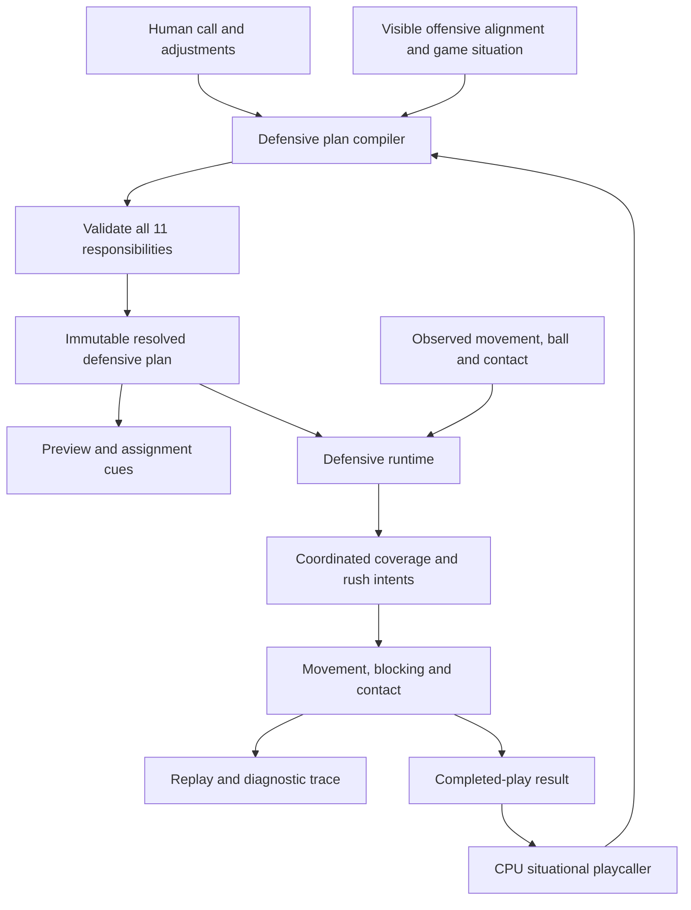

# Defensive gameplay redesign: engineering plan

Updated September 29, 2026. Behavioral design specification. P0–P7 are implemented in their scoped development modes: baseline tooling, shared compiler, live man family, coordinated spot zones, run fits/pursuit, pressure packages, human blitz controls and authored match coverage. Normal gameplay remains legacy until P10. See the [P7 verification](defense-redesign-p07-verification.md), [P6 verification](defense-redesign-p06-verification.md), [P5 verification](defense-redesign-p05-verification.md), [P4 verification](defense-redesign-p04-verification.md), [P3 verification](defense-redesign-p03-verification.md), [P2 verification](defense-redesign-p02-verification.md), and [rule ledger](defense-redesign-rule-ledger.md) for evidence and limits.

For ordered implementation work, use the [engineering execution roadmap](defensive-gameplay-engineering-roadmap.md). It assigns every decision rule and acceptance scenario to a concrete phase with work packages, code areas, and exit gates. This document remains the behavioral specification.

Replace defensive assignment construction and live decision-making with a shared, validated defensive plan and a coordinated runtime. Preserve the existing match, offensive playbook, ball, contact, statistics, and rendering foundations where they remain useful. The defense should be understandable before the snap, maintain coherent responsibilities after it, and lose for understandable football reasons: a mismatch, a well-designed overload, a failed rush, or a player's decision.

The key architectural change is to separate **what each defender is responsible for**, **what they currently perceive**, and **how they move to execute that responsibility**. Today these concerns overlap across factories, assignment repairs, and target-point heuristics.

**1. Findings from the current implementation**

These are verified code observations. Their contribution to individual reported plays still needs reproducible live scenarios; this inspection does not establish that every symptom has one cause.

| Area | Current behavior and evidence | Consequence for the redesign |
| --- | --- | --- |
| Man assignments | `DefenseFactory.BuildManCoveragePlan` assigns WRs by roster role and horizontal order, assigns backs/TEs separately, then performs a uniqueness pass. `DefensivePlayResolver.Resolve` subsequently restores the requested shell, repairs remaining matchups, swaps a star DB's target, and realigns DBs. | A unique matchup is not necessarily a sensible matchup. Solve personnel, reserved help, pressure, target ownership, and final alignment together. |
| Setup paths | Normal timed games use `DefensiveDrive` and the resolved-play path for **both** human and CPU defense. The older `GameSession`/factory path also exists and constructs assignments after routes have been assigned. | Keep the shared timed-game foundation. Remove divergent assignment logic from the older path or adapt it to the same compiler; avoid repairing only legacy scenarios. |
| CPU strategy | `DefensiveDrive.PrepareActors` selects the CPU call using a uniform seeded index into the ten-call book. The existing situational `DefensiveCoordinator` does not make this live selection. | Strategy work must be connected to the production timed-game path, not just added to the existing coordinator. |
| Zone ownership | `ZoneCoverage.TrySelectZoneMatch` independently scores receivers for each defender on each update. It has no shared ownership or accepted-transfer protocol. | Several defenders can favor one threat while another lacks meaningful coverage. Add coordinated priorities and explicit handoffs. |
| Zone rigidity | Deep targets are horizontally clamped inside zone bounds. Zone geometry is derived largely from initial alignment and fixed widths. | Separate a zone's normal responsibility from movement constraints. Zone seams should support controlled overlap and transfers. |
| Match coverage | `DefenseFactory.ApplyUniqueCoverageAssignments` explicitly clears all match targets for Cover 3 Match and Quarters Match. The UI now calls these Cover 3 Buzz and Quarters Zone. Tests enforce local zones. | Real match coverage requires a new behavioral contract and revised tests. Re-enabling the old receiver attachment logic would revive earlier cross-field abandonment. |
| Man movement | `DefenderTargeting` uses immediate target-directed velocity, basic cushion/trail offsets, and authored route-break completion for some DB behavior. Receiver IDs are also treated as list offsets during lookup. | Introduce identity-safe lookup, observed movement, leverage, and stateful steering; do not let assignment correctness depend on list order or hidden route metadata. |
| Human pressure | Keys 9 and 0 already select five- and six-rusher calls. The live defensive branch of `FullMatchSession` does not handle flip input. `ResolvedDefensivePlay.Mirror()` reflects geometry but retains man target IDs against the unchanged offense. | Make pressure selection and the user's job obvious. Implement pressure-side changes by re-resolving against the actual offense; do not wire the existing reflection directly into live controls. |
| Rush behavior | Rushers mainly follow QB-relative lane offsets; ends use a generic outside arc. There is no coordinated gap/timing/contain plan. | Model pressure as a complete rush and coverage package. More rushers alone will not make it smarter. |
| Learning | Blitz selection queries package names, but `DefensiveMemory` records keys formed from blitzer labels. The timed match outcome adapter does not populate the blitzer list. | Carry stable call/package IDs and observed pressure outcomes from selection through the result event and memory. |
| Verification | Existing coverage tests strongly check roster counts, target uniqueness, local alignment, and isolated target points. Some explicitly prohibit the match behavior now being proposed. | Preserve useful structural tests and add full-play temporal tests with independent expected responsibilities. |

Source entry points: [DefensivePlaybook](../RetroQB/Gameplay/DefensivePlaybook.cs), [DefenseFactory](../RetroQB/Gameplay/Factories/DefenseFactory.cs), [DefensiveDrive](../RetroQB/Gameplay/DefensiveDrive.cs), [ZoneCoverage](../RetroQB/AI/ZoneCoverage.cs), [DefenderTargeting](../RetroQB/AI/DefenderTargeting.cs), [FullMatchSession](../RetroQB/Gameplay/FullMatchSession.cs), [DefensiveMemory](../RetroQB/AI/DefensiveMemory.cs), and [MatchState](../RetroQB/Gameplay/Match/MatchState.cs).

Issue 3 is ambiguous in the original request. This proposal assumes human players need reliable, visible blitz selection and pressure adjustments, and includes verification of the existing 9/0 calls. It does not assume those calls are absent from the code.

**2. The new defensive contract**

Use one pipeline for both teams and every scrimmage entry point:



Proposed responsibilities, with implementation names illustrative:

| Component | Owns |
| --- | --- |
| `DefensiveCallDefinition` | Personnel policy, front, coverage, pressure, run fits, and supported adjustments; a stable call ID and version. |
| `OffensiveAlignmentSnapshot` | Ball/LOS, QB, visible linemen, skill-player IDs and positions, sides, receiver ordering, attached/detached threats, and bunch/stack groups. No routes or future blocking releases. |
| `DefensivePlanCompiler` | Resolving legal personnel, shell, rushers, matchups, alignments, help, and transfer relationships in one operation. |
| `ResolvedDefensivePlan` | Exactly 11 stable actor assignments; initial locations; typed pass responsibilities; run responsibilities; pressure paths; adjustment state; controlled linebacker; diagnostic explanations. |
| `DefensiveObservationFrame` | A common snapshot of observed positions, velocities, ball state, and contact. No authored route endpoints, next waypoints, future release times, or selected offensive call. |
| `CoverageCoordinator` | Threat priorities, primary/help ownership, match state, transfer offers and acceptance. |
| `PressureCoordinator` | Entry gaps, rush timing, stunt partners, contain, and reaction to observed protection. |
| `DefenderMotor` | Executing movement intent within speed, turning, arrival, field, blocking, and contact constraints. |
| `DefensivePlaycaller` | Selecting a legal call and adjustments from situation, visible offense, team identity, and completed-play tendencies. |

An assignment has one active pass responsibility, such as `Man`, `Zone`, `Match`, `Rush`, or `Spy`. Its run fit is a separate conditional responsibility activated by a run read. A conditional rush must specify the preceding coverage responsibility and its transition rule; incompatible booleans must not represent simultaneous jobs.

The immutable plan describes intent. Per-play runtime state contains current threat, leverage, recognition timers, transfer status, and movement mode. Rendering reads these structures without making decisions or advancing timers. Reset all runtime state on a new play or restart; preserve it while paused. Recorded replays use recorded state rather than recomputing decisions.

Compute team decisions from the same observation frame, resolve conflicts in stable actor-ID order, then apply movement. Preserve the current offensive/defensive integration order initially and make any later changes explicit. Use simulation-time timers with bounded substeps; gameplay must not depend on rendering frequency. Separate call-selection, alignment, and outcome randomness so browsing cannot reroll the offense or improve a matchup.

**3. Formations and man coverage**

Model personnel, front, and coverage as independent choices. A nickel defense should be able to play several fronts and coverages without a different collection of patches for each combination.

Start with existing 4-3 base and 4-2-5 nickel personnel. Author even, over/under, wide, and short-yardage fronts relative to the visible offensive line and strength, with named gap responsibilities. Add 4-1-6 dime after base/nickel correctness, including the extra DB roster slot, ratings, stars, rendering, and control tests. Dime retains one controllable linebacker. Defer 3-4 rosters and exotic fronts until this foundation is proven.

Use actual ball/line geometry as the formation reference rather than the average receiver position. Classify receiver #1/#2/#3 from outside inward on each side, identify attached TEs and backfield threats, and define deterministic tie-breaking for stacked players. Treat these as formation roles separate from roster labels such as WR1. Hash/boundary adjustments should use actual lateral ball position when supported, rather than inventing a field/boundary distinction at midfield.

Resolve man assignments in this order:

1. Reserve the called deep helpers, robber, and rushers. A two-high call must retain two-high help; the solver cannot silently borrow a safety.
2. Enumerate the visible potential receiving threats. Include backs and TEs who might release; a play's authored blocking assignment must not remove them pre-snap. Support fewer than five skill threats in heavy personnel.
3. Build legal defender/threat pairings. Apply explicit shadow or bracket policies only when selected by the call; star status by itself should not rewrite assignments later.
4. Find the best complete pairing using a small exact assignment solver, such as bitmask dynamic programming. With at most seven coverage players, a deterministic global solution is inexpensive. Prefer sensible alignment travel, leverage, local matchups, and DBs on detached speed threats. Shell integrity and target coverage are hard constraints; roster preference is a cost.
5. Generate final alignment from the completed assignment for **every** coverage defender, including linebackers. Apply press/off depth and leverage, then resolve formation spacing without changing target ownership.
6. Validate target IDs, reserved helpers, player counts, playable positions, and exactly one primary man owner per potential receiver. Helpers are explicitly identified. Reject unsupported combinations with a concrete reason.

For example, nickel Cover 2 Man against four wide receivers may legitimately place a linebacker on a wideout because both safeties are reserved. Show that tradeoff or recommend dime. Do not silently turn it into Cover 1. Against twins on one side and an attached TE on the other, pair by the call's formation rules instead of assuming the leftmost and rightmost WR must always belong to the outside corners.

After the snap, ordinary man coverage keeps its target identity through crossing routes. Movement maintains the called inside/outside and top/trail leverage using observed speed and available help. Bunch/stack calls can use an authored switch rule: two nearby defenders assign the observed releases once and commit. They must not repeatedly swap to whichever receiver is currently nearest.

Against a blocking assignment, a man defender enters a read/hold state and watches for a late release. A green-dog pressure call may send that defender only after sustained observed blocking, with a defined response if the receiver releases. Default man coverage does not abandon the back automatically.

**4. Zone and match coverage**

Replace independent target scoring with a team coverage board. Each zone has a home area, priority rules, neighboring responsibilities, permitted overlap, and a recovery rule. Home areas guide decisions; they are not invisible movement walls.

For each observation update:

1. Estimate threat direction and arrival times from recent observed movement. Distinguish a vertical threat, crossing threat, underneath outlet, and non-releasing player without reading the route enum.
2. Rank threats within each responsibility and its incoming seam area. Deep players prioritize threats to the space behind them; underneath players account for vertical carries and nearby throwing windows.
3. Allocate primary attention and help together. Two defenders may intentionally bracket a threat, but an accidental duplicate commitment must not consume the only viable defender for another higher-priority threat.
4. Retain commitments with hysteresis and minimum commitment intervals. Reevaluate urgently for a newly dangerous vertical or an observed throw, not merely a tiny score change.
5. Offer transfers across neighboring responsibilities. The receiving defender accepts only if their assignment, actual position, and movement capacity permit it. Commit the transfer atomically; the original defender releases after acceptance and a bounded overlap.
6. When no transfer is feasible, use the call's explicit emergency priority and record the resulting exposure. A legitimate overload can leave a window. The runtime must not invent an unreachable helper or chase a receiver across the field indefinitely.

Represent the lifecycle explicitly: `Read -> Drop/Leverage -> Carry or Transfer -> Recover`, with transitions to `BreakOnBall` and `Pursue` when observation warrants them. Keep football state separate from movement mechanics.

Deep coverage needs special treatment:

- Start gaining appropriate depth before a vertical threat reaches the defender. Derive the required cushion from closing speed, recognition delay, turning time, and field space.
- Predict reachable intercept/leverage points in seconds using receiver velocity. Avoid a fixed look-ahead distance that treats fast and slow receivers identically.
- When beaten, take a recovery angle toward a reachable contest point rather than chasing an unreachable ideal position beyond the receiver.
- Allow controlled seam overlap and diagonal carries until a transfer is accepted. Test posts, corners, wheels, and multiple verticals together.
- Compress depth near the end zone while preserving lateral leverage and back-line constraints. Do not try to maintain an impossible cushion outside the field.
- Break toward an observed pass only when the defender can plausibly contest it; account for travel time and ball height. Far-side defenders retain useful leverage until the catch or run is established.

Keep spot zone and match coverage distinct. Spot zones protect space with temporary carries and transfers. Match calls turn observed releases into durable matchup rules. Restore match coverage only with authored tables for #1/#2/#3 and closed-side threats; never by simply restoring the old unconditional attachments.

Suggested initial identities:

| Coverage | Defining behavior | Intended offensive opportunity |
| --- | --- | --- |
| Cover 2 Zone | Two deep halves; corners control flats and pass verticals to deep help. | Stress a safety with a sideline/seam combination. |
| Cover 3 Zone/Buzz | Three deep; underneath players distribute crossers and carry seams until transferred. | Create an underneath or flood overload. |
| Cover 4 Zone | Four deep priorities with conservative overlap and short support. | Take short gains and run against a lighter support structure. |
| Cover 3 Match | Outside vertical ownership plus explicit inside-release and seam rules. | Challenge the match rules with release combinations and traffic. |
| Quarters Match | Side-based #1/#2 reads, vertical commitments, and explicit crossing exchanges. | Force a safety conflict with a legitimate multi-route concept. |

Exact thresholds are tuning data. Neither an always-in-bounds target nor a universally prevented completion is a valid definition of successful zone coverage.

Section 12 supplies the initial decision matrices, including release definitions, scheme-specific ownership, transfers, pressure transitions, and expected scenario outcomes. These are the proposed behavioral contracts for implementation and review.

**5. Smarter pressure and run defense**

A pressure package must declare the rush count, entry gaps, launch timing, contain players, optional stunt partners, coverage replacements, and run fits. Validate the whole package before offering it to either side.

Begin with four well-defined behaviors:

| Package | Rush and coverage structure | What makes it useful |
| --- | --- | --- |
| Four-man contain | Two interior rush lanes and two coordinated edge responsibilities. | Compress the pocket while preserving coverage and controlling escape. |
| Five-man pressure | A named Mike, edge, or nickel entry with an explicit coverage exchange. | Attack a gap or overload one protection side without losing a receiver by accident. |
| Six-man Cover 0 | Six rush lanes and five primary man assignments against five threats. | Force a quick decision in exchange for no deep help. |
| Five-man zone pressure | Three deep and three underneath responsibilities, with authored rotation/drop roles. | Present pressure while preserving a defined coverage structure. |

Follow with a small number of verified stunt and delayed/green-dog variants. A simulated pressure that sends a linebacker and drops a lineman still counts its actual rushers; require roster-appropriate drop capability and preview the exchange. Avoid a combinatorial menu of arbitrary blitz toggles.

Rush execution becomes staged: approach the entry gap, engage/penetrate, react to contact, preserve contain, then close on the QB. Ends should not always take the same large arc. Stunt partners have ordered paths so they do not collide or repeatedly choose the same opening. Select the pressure side using visible protection surfaces and past tendencies; react to actual blocks after the snap instead of reading the offense's hidden protection plan.

Keep the existing blocking/contact system as the physical authority. Integrate runtime rush status with `PassProtectionPlanner` and blocking threat selection so delayed rushers and dropping defenders are represented correctly. Verify overloads and stunts against real protection, including a releasing RB and play action. An artificial free runner caused by stale blocker targeting is not evidence that the pressure design works.

Add run fits to the same plan: interior gap, edge force/contain, cutback, and deep support. Defenders read the observed exchange with bounded recognition delays, preserve useful angles, and transition to pursuit after a confirmed handoff/catch or QB run. Play action should create a measured conflict. The entire defense should not abandon its structure merely because one actor starts moving toward the LOS.

**6. Human defensive playcalling and controls**

Keep the fast ten-key call sheet and the fixed-linebacker control model. Organize the underlying catalog into coverage and pressure families so the quick sheet can expose useful alternatives without forcing a multi-step formation menu every snap.

- Show personnel, shell, rush count, pressure side, and the controlled player's exact job before the snap. For example: `Nickel / Cover 1 / 5 rush / YOU: left edge contain blitz`.
- Make pressure calls visually identifiable. Verify both number keys and the actual input-to-selection-to-snap path, including 0 for the tenth call.
- Use X to flip supported pressure direction. Recompile the call against the unchanged offense, recompute replacement coverage and paths, and retain the designated controlled linebacker. Flipping twice restores the original resolved plan without rerolling randomness.
- Offer a small optional pressure-variant control, proposed as pre-snap Q/E, only after checking all input contexts. Cycle through validated variants such as Mike, left edge, and right edge. A variant that sends the controlled linebacker must say so explicitly.
- Show unsupported variants as unavailable with a short football reason, such as insufficient coverage players. Keep the last valid call active. CPU selection filters the same invalid variants.
- Draw actual rush paths, man ownership/leverage, and zone home areas from the resolved plan. Use a subdued live cue for the user's current assignment and a clearer cue when that assignment changes through a called rule.
- Preserve the offensive call and snap deadline while browsing or adjusting. Pause, replay, and focus-loss rules remain under the match clock's authority.

Human input owns the linebacker throughout the play, including on a called blitz. An idle human linebacker does not automatically rush. AI teammates retain their planned responsibilities, and transfer acceptance involving the human must use the player's actual position. A player can abandon a job, and that can create an opening; authored help may respond, but the defense cannot magically erase the consequence.

Ship improved cues with the core rewrite. A separate coach mode, defender switching, manual tackles/swats, and arbitrary pre-snap repositioning are later gameplay decisions.

**7. CPU strategy and team identity**

Connect the new playcaller to `DefensiveDrive.PrepareActors`, the actual timed-game entry point. CPU and human calls use the same catalog, compiler, pressure rules, and movement abilities. The human-controlled actor is the explicit execution difference.

Score legal calls using down/distance, field position, score, time remaining, timeouts, visible formation, team strengths, QB escape tendencies observed earlier, and completed-play outcomes. Use bounded weighted selection so teams have recognizable tendencies without becoming deterministic or repeating one apparently successful call forever.

Persist stable call, coverage, front, and pressure IDs into completed-play metadata. Record actual pressure participants and conditional transitions. Update memory once per completed play, crediting the team that defended. Keep learning bounded and appropriately responsive to short two-minute halves. Reset it with the match; preserve existing restart semantics.

For illustration: against a strong mobile QB, value contain and occasional spy rules; after repeated slow-developing passes, increase legal pressure; when protecting a late lead, value explosive-play prevention. None of these choices may inspect the current offensive play name, intended target, or future route path.

**8. Implementation sequence and acceptance gates**

Deliver the rewrite in coherent vertical slices using the [detailed P0-P10 roadmap](defensive-gameplay-engineering-roadmap.md). These phase numbers replace the earlier seven-phase outline. The roadmap provides the implementation checklists and rule/scenario ownership ledger; the table below is the overview.

A development-only old/new switch allows comparison during migration; each snap must execute one complete plan and runtime. The new-engine mode exposes only its completed supported calls until cutover. Do not mix old assignment repair with the new coordinator in a released play.

| Phase | Deliverable | Exit gate |
| --- | --- | --- |
| [P0. Reproduction and measurement](defensive-gameplay-engineering-roadmap.md#p0) | Deterministic DM fixtures, decision/trajectory traces, refreshed test baseline, and failure reproductions. | Cases rerun reliably; existing unrelated failures and expected new behavior are distinguished. |
| [P1. Shared plan compiler](defensive-gameplay-engineering-roadmap.md#p1) | Visible alignment, stable IDs, typed responsibilities, exact man pairing, validation, and passive spawning. | Supported plans preserve shell/rush budgets and preview parity across catalog formations/flips; hidden route changes cannot alter assignments. |
| [P2. Live Cover 1 slice](defensive-gameplay-engineering-roadmap.md#p2) | Observation, runtime state, motor, man leverage, middle help, four-man contain, control, and replay integration. | A complete live play executes through production controllers for either defending team with valid physics and lifecycle behavior. |
| [P3. Complete man family](defensive-gameplay-engineering-roadmap.md#p3) | Cover 0, Cover 2 Man, Robber, delayed-release responsibility, bunch switches, and explicit shadow/bracket rules. | Man assignments remain coherent through traffic and release changes; all family-specific help budgets hold. |
| [P4. Coordinated spot zones](defensive-gameplay-engineering-roadmap.md#p4) | Coverage board, atomic handoffs, spot-zone priorities, deep recovery, and human-aware transfer acceptance. | Seam/vertical/flood cases have accountable ownership or explicit concessions; no silent dropped or duplicated commitments. |
| [P5. Run fits and pursuit](defensive-gameplay-engineering-roadmap.md#p5) | Provisional run reads, force/cutback/deep support, play-action recovery, QB escape, and after-catch pursuit. | Confirmed runs produce coordinated fits; moving QBs/fakes do not cause premature universal coverage abandonment. |
| [P6. Pressure and human controls](defensive-gameplay-engineering-roadmap.md#p6) | Fixed/zone/simulated pressure, delayed/green-dog/stunt rules, protection integration, real 9/0 inputs, side/variant adjustment, and cues. | Previewed legal pressure executes through real input/contact; rush/drop flags, coverage replacements, control, and clocks remain correct. |
| [P7. Match coverage](defensive-gameplay-engineering-roadmap.md#p7) | Cover 3 Match, Quarters Match, Trips Poach, closed-side handling, and named fallback checks. | Authored release/transfer rules pass; former spot-zone regressions retain their appropriate coverage semantics. |
| [P8. Fronts and dime](defensive-gameplay-engineering-roadmap.md#p8) | Additional front templates, 4-1-6 personnel, roster/control/rendering integration, and legal selection. | All advertised combinations have 11 valid actors, correct ratings, one supported controlled linebacker, and verified responsibilities. |
| [P9. CPU strategy and memory](defensive-gameplay-engineering-roadmap.md#p9) | Live situational selection, team/tendency scoring, stable outcome/package IDs, and bounded learning. | Actual timed-game call distributions respond to context; outcome data updates the same IDs selection reads; all decision rules have phase evidence. |
| [P10. Balance and cutover](defensive-gameplay-engineering-roadmap.md#p10) | Full matrix/team/frame-rate testing, hands-on review, performance measurement, compatibility, and removal of obsolete paths. | No new regression failures; all rule/scenario gates have evidence; normal play uses the new engine and meets the documented quality/performance gates. |

P1-P6 address the core reported failures. P7-P9 deliver the wider match-coverage, formation, and CPU-strategy redesign; P10 establishes release readiness. Avoid tuning overall defender speed or sack probabilities until ownership and movement failures have been separated.

Every implemented matrix row in section 12 must have a stable rule ID, a decision-trace reason, and at least one scenario asserting its trigger, action, and exit/fallback. Use the matrix version in the resolved plan and replay metadata. The phase that introduces a rule also owns its tests; do not defer all matrix verification until P10.

**9. Verification that measures gameplay**

Use existing xUnit and headless scenario infrastructure. Do not build a second approximate simulator for the acceptance tests.

The matrix should include:

- All offensive catalog formations, both offensive flips, supported defensive personnel, coverage/pressure combinations, and both human/CPU team roles.
- Balanced, twins, trips, empty, bunch, stack, attached-TE, heavy/six-lineman, and compressed goal-line surfaces. Add synthetic geometries only where the runtime supports them.
- Current supported field positions from own goal line through midfield and the opponent's 20/10/5/1; both rendered orientations.
- Slants, mesh, deep crossers, posts, corners, wheels, four verticals, flood, delayed back/TE releases, screens, play action, inside/outside runs, and QB escape.
- Normal and edge pressure, mirrored pressure, manually vacated linebacker responsibility, and unavailable coverage replacements.
- 30/60/120 Hz stepping, varied deterministic seeds, and representative slow/fast team matchups; broaden to the team catalog before cutover.

Use three kinds of assertions:

| Kind | Example acceptance criterion |
| --- | --- |
| Structural, exact | Eleven actors, valid stable IDs, one active pass job each, exact called rush/shell counts, no missing primary in man, and no mutation when previewing. |
| Temporal, scenario-specific | A deep defender with adequate initial leverage stays responsible through a diagonal seam crossing; a transfer never leaves both owners released; a flat route does not pull every deep defender down; a delayed releasing back remains accounted for. |
| Aggregate and experiential | Pressure improves time-to-QB-threat at an understandable coverage cost; different calls create different openings; teams retain strengths; the user's positioning materially affects play without AI assistance hiding mistakes. |

Author expected ownership and transition outcomes independently of production target functions. Compare movements and event order over an entire play, including the catch/recovery phase. Frame-rate tests should compare football outcomes and declared positional tolerances, not require bit-identical floating-point trajectories at different step sizes.

Record assignment changes, ownership gaps and their reasons, handoff acceptance, duplicate commitments, available deep cushion, separation at throw/catch, recovery angle, time to pressure, pressure source, containment escapes, sacks, explosive gains, and run-fit integrity. An uncovered threat caused by an intentional overload or human abandonment must be distinguishable from an assignment defect.

Require zero invalid plans, lost valid IDs, unexplained man ownership gaps, or unaccepted transfers that release both owners in deterministic fixtures. Set positional tolerances and aggregate balance bands from the phase-0 baseline and authored scenario expectations before tuning. Do not promise a universal completion-rate target or zero deep completions. Pair old/new aggregate runs by seed and report sample sizes and variation.

Add an optional developer overlay showing responsibility, observed primary threat, decision state/reason, transfer neighbor, target point, rush gap, and movement constraint. Store compact transition events for headless failures. Keep full per-tick traces opt-in so normal gameplay/replay memory remains bounded.

Profile the compiler and runtime in release configuration after warmup on a recorded machine specification. A proposed initial budget is under 5% of a 60 Hz frame for defensive decisions at p95, with no avoidable per-tick allocation; confirm or revise this budget from the baseline. Performance must be measured separately from rendering and test-runner overhead.

Existing tests such as `FormerMatchShellsKeepEveryDefenderInALocalZone` and `ZoneCallsNeverSendDefendersAcrossTheFormation` must be split by coverage semantics. Keep their spot-zone intent and replace unconditional match restrictions with ownership/transfer assertions in the same change that introduces the new behavior. Do not remove regressions merely to make the rewrite pass.

**10. Code migration and compatibility**

| Existing area | Intended treatment |
| --- | --- |
| `Gameplay/DefensivePlaybook.cs` | Separate catalog definitions, compiler, immutable plans, and preview data. Preserve or explicitly map existing call IDs. |
| `Gameplay/Factories/DefenseFactory.cs` and coverage policies | Move formation geometry into reusable templates; replace man/zone repair passes with the compiler. Make entity creation a simple instantiation step. |
| `AI/ZoneCoverage.cs` | Retain useful field geometry initially; replace independent threat selection and hard movement bounds with coordinated responsibilities. |
| `AI/DefenderTargeting.cs` | Replace assignment decisions with coverage/pressure/run intents and a motor. Remove authored-route lookups from defensive perception. |
| `Entities/Defender.cs` | Keep entity identity, ratings, and physical state. Move tactical runtime state into an explicit per-play structure; expose derived compatibility flags during migration only. |
| `PlayExecutionController` and blocking planners | Integrate observation, team decisions, manual input, movement, and contact exactly once per step. Preserve contact authority and catch/tackle behavior. |
| `DefensiveDrive`, `FullMatchSession`, input interfaces | Own selection/adjustment state, immutable per-snap plan, real CPU playcalling, and end-to-end human blitz controls. |
| `DefensiveCoordinator`, blitz strategy, memory, result records | Consolidate call scoring; replace label-derived keys with stable IDs; include actual pressure metadata. |
| Defensive/full-match renderers and replay | Render the compiled plan and recorded runtime transitions, with no new gameplay decisions in drawing code. |

Append new roster enum values rather than renumbering existing ones, and audit any serialized use before adding dime. Provide default profiles and explicit team tuning for new positions. Keep old score records readable, and test restart, team ownership, controlled-slot selection, stars, and replay after possession changes.

If a development-authored call is invalid, fail loudly with an actionable validation report. In normal play, retain the last valid human selection; CPU calling chooses from validated candidates and has a known legal base fallback. Never repair an invalid plan silently after its preview has been displayed.

**11. Baseline and first implementation slice**

Baseline command run on September 26, 2026:

```powershell
dotnet test tests/RetroQB.Tests/RetroQB.Tests.csproj --no-restore --verbosity minimal
```

Result: **622 tests; 617 passed, 5 failed, 0 skipped**. Failures existed before this plan's documentation change:

- `FieldGoalTests.OutOfRangeCannotSnap`.
- `TimedSeasonTests.REPLAY01_ReplayAfterPossessionChangeKeepsRecordedTeamClockAndLinebacker`.
- Three cases of `HalvesAndSpecialTeamsTests.CpuPuntsOnlyWhenPinnedBackWithLongYardage`.

Track and triage those failures before judging a later full-suite regression result. Existing passing coverage tests establish their current assertions, not satisfactory defensive gameplay. This planning pass did not include interactive playtesting.

The first implementation slice should capture adversarial man/zone scenarios and build the shared plan compiler with one complete Cover 1 vertical slice: visible formation -> legal assignments and alignment -> preview -> snap -> live man execution -> diagnostic result. Establish that contract before converting the remaining shells and pressure packages. This gives every subsequent feature a single place to declare its responsibilities and a direct way to prove that players execute them.

**12. Defensive decision matrices**

These tables define proposed RetroQB behaviors. They are intentionally bounded game rules, not a claim to reproduce every real-world coaching system. Numbers below are initial tuning proposals, not measured results. Changing a rule requires updating its matrix row, trace reason, and scenario expectations together.

**12.1. Vocabulary, observations, and evaluation order**

Receiver numbers refer to the snap-time formation: #1 is the outermost threat on a side, then #2 and #3 inward. They are separate from roster names and remain stable through a play. Track a backfield release by actor ID and destination side; do not renumber every receiver when players cross. `Strong` means the compiler's declared formation strength, with a deterministic tie-break. `Inside/outside` refer to the ball and nearest sideline in offense-relative coordinates, independent of screen orientation.

`Primary` is the defender accountable for a receiving threat under a man, carry, or match rule. `Help` is an additional, explicit responsibility. Spot zone does not require every receiver to have a permanent primary; the board must account for each threat entering a protected responsibility and record conflicts or deliberate concessions. A help player cannot count as a primary replacement until a transfer is accepted.

Functional roles such as corner, apex (between an inside receiver and the box), hook, middle safety, and robber bind to distinct active actors. They are not assumptions that a particular roster slot is always present. The compiler assigns the roles for base, nickel, and dime, and validates the budget before aligning them.

| Signal / rule ID | Initial observable definition | Guard against false reads |
| --- | --- | --- |
| OBS-01: release direction | Estimate velocity/displacement over the last 0.15 seconds of simulation. Classify a stable outward, inward, or upfield release after 0.12 seconds of consistent evidence. | Zero velocity is `Unknown`, not a route prediction. Contact can interrupt confidence; retain the prior responsibility while uncertain. |
| OBS-02: vertical threat | Receiver is at least `V` yards beyond the LOS and has advanced at least 0.8 yards in the preceding 0.20 seconds; also trigger immediately when an observed upfield threat could erase the defender's cushion within 0.60 seconds. | Start with `V = min(6, max(1.5, 0.35 * usableDepth))`, where usable depth ends at the playable back line. A pre-vertical stem remains a potential vertical, so deep defenders gain depth before classification. |
| OBS-03: short out / shallow in | Stable outward/inward release below `V`, with lateral speed exceeding upfield speed. A receiver who subsequently turns upfield becomes a wheel/vertical threat under OBS-02. | A short out is not a permanent declaration that the receiver cannot go deep. No route-enum inspection. |
| OBS-04: observed blocking | Close contact with a defender and sustained movement consistent with engaging that defender for 0.35 seconds. | Being stationary or standing near the QB is insufficient. The defense cannot read `IsBlocking`, authored release time, or the future protection assignment. |
| OBS-05: late release | A previously engaging receiver separates and shows stable route movement for 0.12 seconds, or presents an immediate observable receiving threat. | The receiver's blocking animation/metadata alone cannot keep them classified as a blocker. |
| OBS-06: run confirmation | Visible completed handoff/catch, or a QB holding the ball beyond the LOS. Before confirmation, line/backfield flow may produce a provisional run read. | A fake exchange or a QB moving inside the pocket is not a confirmed run. Deep coverage retains its pass rules during a provisional read. |
| OBS-07: pass recognition | Ball release and flight become observed after an initial 0.12-second recognition delay, subject to a bounded rating-based range of 0.08-0.25 seconds. | Use observed ball flight and height to estimate a reachable contest point; do not expose the selected receiver or a hidden throw command. |
| OBS-08: commitment stability | Ordinary threat changes require at least 0.25 seconds in the current commitment and a challenger score at least 20% higher on a documented, nonnegative urgency scale. | Accepted transfers, observed throws, confirmed runs, lost possession, and imminent lost deep leverage can bypass the ordinary timer. Ties preserve the current valid commitment, then use stable actor IDs. |

All timers are per defender or transfer, use simulation time, and freeze with the match. The recognition range changes when a defender reacts; it never changes which hidden information they can access. Use the same observation rules for both teams. Ratings affect bounded recognition/movement capability, not ownership validity.

For OBS-08, compare threats within the same scheme priority class using an initial `urgency = 1 / max(0.10, estimatedSecondsToThreatenedWindow)`. Estimate arrival from observed movement toward that role's protected window or top-leverage boundary over a maximum 1.5-second horizon; no predicted arrival gives urgency zero. A newly imminent deep loss or a mandatory uncovered responsibility changes the priority class and can bypass ordinary hysteresis. Scheme rules still decide which space matters: the formula cannot make a deep safety prefer a short outlet just because it is closer.

At each simulation step, evaluate the following precedence. Coordinators may prepare decisions for a human-controlled defender, but only human input produces that actor's movement.

| Priority / rule ID | Condition | Decision |
| --- | --- | --- |
| 0 / DEC-00 | Whistle, terminal play, or suspension | Stop tactical transitions and movement as required by match state. |
| 1 / DEC-01 | Confirmed live ball carrier | Activate run fits/pursuit; preserve force, cutback, and last-defender roles until a tackle opportunity requires commitment. |
| 2 / DEC-02 | Observed ball in flight | A reachable defender breaks to contest; others preserve receiver leverage and prepare a post-catch angle. |
| 3 / DEC-03 | Imminent vertical behind a deep responsibility | Preserve/recover deep leverage; abort a discretionary short-route jump. Use the scheme's conflict rule if two threats compete. |
| 4 / DEC-04 | A legal transfer/switch can commit | Resolve the complete ownership transaction from the shared observation frame, then issue movement intents. |
| 5 / DEC-05 | Assigned rush, coverage, or provisional run read | Execute the applicable package row below. Uncertain coverage reads retain responsibility and gain appropriate depth; they never default to rushing the QB. |

Physical speed, turning, collision, blocking, and field boundaries constrain every decision, including emergency decisions. A correct tactical target does not authorize teleportation, extra speed, or passing through another player.

When no specific row matches, retain the valid primary/provisional ownership and execute its leverage rule; an uncommitted zone player protects its home area and observes incoming threats. A stopped receiver, double move, or extended QB scramble does not reset assignment identity. Loss of a valid actor reference is an invariant failure to diagnose, not a football trigger to rush or pick a random target. No live-play row is allowed to rewrite the full pre-snap plan.

**12.2. Pre-snap formation and assignment matrix**

| Rule ID / visible surface | Personnel/front and coverage decision | Assignment constraint / fallback |
| --- | --- | --- |
| ALIGN-01: balanced two threats per side | Use the selected legal base/nickel/dime package; bind side-based corners and underneath players to local threats, reserving the called help. | Do not reorder roster identities after target binding. A chosen personnel mismatch remains visible rather than silently changing the shell. |
| ALIGN-02: trips | Declare the three-threat side strong, identify #1/#2/#3, and select the call's explicit trips check before the snap. | Reserve the weak isolated receiver's owner and the back's owner. Extra attention to trips cannot silently consume either. |
| ALIGN-03: twins with a closed opposite side | Recognize the attached TE on the closed side as a potential receiver. Allocate man players by final pairing; zone players retain the called closed-side responsibilities. | Never invent an opposite wideout. A corner may cover an attached TE or relocate in man according to the compiled assignment. |
| ALIGN-04: bunch or stack | If the call supports a switch, bind a release group, its participating defenders, and an explicit partition such as outermost/innermost release. Align with enough separation to execute it. | Ordinary man locks actor IDs. Unsupported switch geometry falls back to declared lock man before preview; no nearest-receiver swaps after snap. |
| ALIGN-05: empty / four or five detached threats | Prefer nickel or dime in the CPU personnel policy; retain the human's legal chosen package. Distribute all potential receivers before adding discretionary help. | A safety reserved by the shell stays reserved. If no legal complete assignment exists, exclude the call; do not conceal a missing target behind a help label. |
| ALIGN-06: heavy / six offensive linemen | Align the front using the visible line surface and attached threats; consider base and short-yardage fronts. | Count the actual skill threats, which may be fewer than five. Assign surplus coverage players explicit help, spy, or fit roles. |
| ALIGN-07: offensive flip or supported movement before snap | Re-evaluate the visible surface and resolve ownership/alignment using the same call and stable resolution seed. | Preserve call intent and controlled actor policy; cache by visible geometry and adjustment state. No post-snap recompile. Future motion support must choose an explicit travel/bump check rather than resetting the play. |
| ALIGN-08: pressure-side adjustment | Resolve the new gaps, rushers, replacement coverage, and leverage together against the unchanged offense. | Preserve the controlled linebacker identity within unchanged personnel. Reject a variant whose replacement cannot align legally; flipping twice restores the initial plan. |

**12.3. Man coverage and help matrix**

Against five potential receivers, the standard budgets are: Cover 0 pressure = six rushers and five man owners; Cover 1 = four rushers, five man owners, one middle safety, and one low helper; Cover 1 pressure = five rushers, five man owners, one middle safety; Cover 2 Man = four rushers, five man owners, two deep helpers; Robber = four rushers, five man owners, one middle safety, one robber. Conditional green-dog transitions are governed separately by PRESS-08. With fewer threats, the compiler explicitly names the surplus responsibility.

| Rule ID / call and trigger | Primary action and leverage | Help, exit, and failure behavior |
| --- | --- | --- |
| MAN-01: Cover 0, receiver releases | Keep the assigned actor through all cuts. Default to inside leverage with enough top cushion to contest a vertical; only a called press variant closes early. | No deep helper exists. If beaten, recover toward a reachable contest/tackle point. Never abandon the target to become an extra rusher merely because separation grows. |
| MAN-02: Cover 1, receiver releases | Lock the assigned actor; shade to funnel toward available middle help. Use trail leverage only when that help can actually affect the threat. | An outside fade with unreachable middle help requires the primary's own top leverage. The low helper handles a called bracket/crosser/spy role without stealing a primary. |
| MAN-03: Cover 1 middle safety, multiple threats | Prioritize an unhelped threat with imminent lost top leverage; otherwise midpoint the most dangerous two inside verticals at a depth that protects both as long as feasible. | Commit to one when midpoint coverage is no longer reachable. Use time to threatened space, separation, and stable IDs to break conflicts; retain the other primary and record the concession. |
| MAN-04: Cover 2 Man | Primaries keep inside/underneath leverage when their assigned half safety is reachable; safeties cap threats in their respective halves. | Safeties transfer seam help atomically. An underneath break does not pull both safeties down; no safety becomes a permanent primary without an authored transition. |
| MAN-05: Robber, crosser enters low middle | The robber helps on the first high-priority reachable inside window while ordinary man owners retain their targets and the middle safety stays deep. | Jump only while the robber can recover to the called low-middle area. If two crossers conflict, choose the more urgent reachable window; the other retains its man owner. Do not carry a shallow crosser to the far sideline. |
| MAN-06: locked receivers cross or create traffic | Preserve target identities; steer around teammates and recover leverage on the same receiver. | A collision may create real separation. The coordinator cannot cure it by silently swapping unrelated man assignments. |
| MAN-07: called two-player bunch switch | Once releases separate enough to establish the authored inside/outside ordering, assign both targets in one transaction, then lock those IDs. | If ordering remains ambiguous beyond the initial 0.40-second switch window, retain the provisional lock pairing. Three-player bunch requires a separate three-player rule and bijection test; a two-player switch cannot consume its third defender. |
| MAN-08: assigned receiver blocks or delays | Hold a position that can react to a release while supporting the called fit within that constraint. Watch that same actor. | Default man stays accountable. Only a named green-dog variant can convert to rush. On late release, use observed movement and normal recognition delay. |
| MAN-09: explicit star shadow or bracket | Apply the preselected shadow pairing or named primary-plus-helper relationship, including its alignment cost. | Neither star status nor a receiver's early success authorizes a mid-play reassignment. If the bracket creates an illegal coverage budget, reject it before the snap. |

**12.4. Spot-zone matrix**

Standard four-rusher budgets: Cover 2 has two deep/five underneath; Cover 3 has three deep/four underneath; Cover 4 has four deep/three underneath. The compiler names every underneath area and its neighbors, including the extra Cover 2 player. Buzz changes the actor rotating into an underneath area and its approach path; it does not add an extra defender or implicitly activate match rules.

| Rule ID / scheme and observed combination | Coordinated response | Conflict / release rule |
| --- | --- | --- |
| Z2-01: Cover 2, #1 vertical with #2 underneath | Flat corner carries #1 until the half safety accepts it, then recovers toward the flat; the local underneath player handles #2's window. | If the safety cannot accept, the corner continues the carry inside its permitted overlap and calls the declared underneath replacement. If no replacement is reachable, expose the short flat rather than dropping the vertical silently. |
| Z2-02: #1 sideline vertical and #2 seam | Corner stays involved with #1; half safety gives first deep attention to the seam when the corner retains viable top coverage; the adjacent hook carries the seam until acceptance. | If both verticals beat available leverage, safety chooses the earlier deep threat. The other retains its current carrier where possible; record a two-threat conflict. Do not have corner and safety both abandon #1 for #2. |
| Z2-03: flat plus intermediate corner plus seam | Flat player takes the short outside window, hook contests the intermediate entry, safety protects the deeper threat; board declares which route overloads those responsibilities. | An intermediate sideline window may remain. A safety cannot leave an imminent seam solely to erase that window. |
| Z3-01: Cover 3, four verticals | Outside deep players protect the outside verticals; local underneath players carry the inside seams; middle safety helps the more urgent seam. | One middle safety cannot be primary on both seams. A seam carrier releases only to an accepting deep player; the other continues its bounded carry or records the explicit conflict. |
| Z3-02: flood to one sideline | Deep outside player protects the deepest threat, curl player contests the intermediate threat, flat player handles the short outlet if present in that call's area allocation. | Preserve deepest priority. If one underneath actor must handle curl and flat, choose the intermediate threat while it is immediately viable, then rally short; the short concession is expected. |
| Z3-03: post crosses a deep-third seam | Original deep owner offers to the middle player; destination accepts only if it can cover the post without abandoning a more urgent primary. | Continue temporary carry until acceptance or an explicit conflict decision. The original corner then regains outside depth rather than following the post indefinitely. |
| Z3-04: buzz rotation at snap | Named rotating player travels to its compiled hook/curl responsibility while the remaining three deep players maintain the previewed shell. | The approach path must meet the local vertical response window. A slow rotation cannot be treated as completed simply because the actor has the right role label. |
| Z4-01: Cover 4, outside vertical plus inside seam | Outside quarter prioritizes the outside vertical; inside quarter prioritizes the seam; underneath player protects the short window and assists the vertical entry. | Boundary overlaps support exchanges, but neither quarter follows an unrelated shallow route while its vertical is still threatening. |
| Z4-02: inside short out with outside vertical | Inside quarter holds depth and helps cap #1 only if no other inside vertical threatens; underneath player contests the out. | If the out turns into a wheel, restore an appropriate deep primary via the board before the helper leaves its former responsibility. |
| Z4-03: shallow crossers under empty deep areas | Underneath players exchange crossers; unthreatened quarters squeeze toward useful help while retaining recovery depth. | Empty space alone is not permission for every deep player to attack the same short receiver. At least the called deep structure remains until throw/run confirmation. |
| ZONE-01: receiver exits a spot zone | Offer a transfer to the declared neighbor, then recover toward the next incoming threat after acceptance. | Maximum ordinary overlap is an initial 0.60 seconds or 5 lateral yards beyond the home area, whichever occurs first. At that boundary, resolve an explicit conflict: deep roles retain the highest vertical threat; underneath roles recover to their called area if no receiver can take over. Z2-01/02's corner remains the provisional outside-vertical carrier when safety acceptance fails, records the vacated flat, and requests its adjacent hook's declared flat replacement within 5 lateral yards and actual reachability. That replacement records the vacated hook and cannot consume an occupied seam carrier. Record every conceded threat rather than inventing ownership. |

Spot-zone carries temporarily protect a threat; they do not become unrestricted lock man. The overlap limit is suspended only for an explicit emergency deep-priority decision, which must log the vacated area and be reevaluated as the threat or help changes.

**12.5. Cover 3 Match matrix**

Use a deliberately limited initial family: outside vertical locks, inside-release matching, and a declared trips check. Bind seven distinct coverage roles: strong/weak outside deep corners (`Cs`, `Cw`), middle safety (`F`), strong/weak apex (`As`, `Aw`), and strong/weak hook (`Hs`, `Hw`). All four underneath actors can carry a threat under these rules; roster ability still limits execution. The nominal three-deep shell describes initial responsibility, not a prohibition on seam carries.

| Rule ID / release combination | Primary ownership and response | Handoff / fallback |
| --- | --- | --- |
| M3-01: two receivers per side, both #1s and #2s vertical | Each corner locks its side's #1; each apex carries its side's #2. `F` helps the most urgent seam; the compiler-designated back owner among `Hs/Hw` watches the RB, and the other hook protects the low middle. | No apex releases a seam merely because it enters `F`'s geometric third. A transfer requires `F` to accept that specific actor. |
| M3-02: #2 short out, #1 vertical | Apex matches #2 outward and remains ready for its wheel; corner owns #1; `F` retains inside deep help. | Apex can hand a settling short out to an available declared underneath neighbor, then regain seam responsibility. If it cannot transfer, it retains the actor. |
| M3-03: #2 shallow in, #1 vertical | Apex carries #2 into an accepting hook responsibility, then gains depth under #1/next seam threat. | A hook already owning a releasing back may decline. Apex retains the crosser until the match exchange is legal; unlike spot zone, it does not release solely at a home-area limit. |
| M3-04: #1 shallow in/out, #2 vertical | Corner keeps provisional ownership of #1 until an underneath player accepts; apex carries #2. After the shallow transfer, corner can accept #2 and free the apex only through a second validated transaction. | The coordinator may commit the whole chain atomically if all destinations are viable. Otherwise retain the existing ownership; never execute half the chain. |
| M3-05: trips #1/#2/#3 vertical, weak isolated receiver, RB | `Cs` owns strong #1; `As` owns #2; `Hs` carries #3; `Cw` owns the isolated receiver; `Hw` owns RB. `F` prioritizes help on #3 unless a more urgent lost deep threat exists. `Aw` protects weak underneath/help. | This is five explicit owners plus two helpers. A weak-side helper does not leave an unaccounted back or isolated receiver to assist trips. |
| M3-06: trips #3 crosses shallow while #1/#2 stay vertical | `Hs` carries #3 toward `Hw/Aw`; transfer to one only if it is free of an incompatible primary and can arrive. `F` redistributes deep help after the shallow read is reliable. | `Hw` retains RB if it releases. If neither weak underneath player can accept, `Hs` carries #3 as a matched crosser; the vacated hook is the documented tradeoff. |
| M3-07: closed-side TE releases vertically | Treat the TE as that side's actual #1; its corner owns the vertical, while local underneath players account for backfield releases. | A corner does not vacate the closed side to find a nominal WR elsewhere. |

**12.6. Quarters Match matrix**

Bind seven distinct roles: two corners (`Cs/Cw`), two safeties (`Ss/Sw`), two apex players (`As/Aw`), and one middle/back player (`M`). The base two-by-two check is vertical matching; the trips check is explicitly named `Trips Poach`. The weak isolated corner locks its receiver through every release in that trips check, allowing the weak safety to help inside. Do not activate the poach after the snap without that predeclared ownership arrangement.

| Rule ID / release combination | Primary ownership and response | Handoff / fallback |
| --- | --- | --- |
| QM-01: two-by-two, #1 and #2 vertical on both sides | Corners lock #1, safeties lock #2 after the vertical read; apex players carry #2's initial stem until safety acceptance, then protect underneath. `M` watches the back. | Safety ownership begins only when reachable. Until then apex retains the carry and the safety is help/approaching, not an imaginary completed replacement. |
| QM-02: #2 short out, #1 vertical | Apex owns the out/wheel; safety maintains depth and helps #1 from inside; corner remains #1's primary. | If #2 turns up, safety accepts it when feasible before withdrawing that help. Apex remains on the wheel while acceptance is pending. |
| QM-03: #2 shallow in, #1 vertical | Apex carries the shallow route toward `M` or the opposite apex if available. Safety helps cap #1 after confirming no inside vertical. | `M` cannot accept a crosser while abandoning a releasing back. Retain the apex carry or use the free opposite apex; log the underneath space conceded. |
| QM-04: #1 shallow, #2 vertical | Corner offers #1 to an available underneath defender; safety retains #2. After acceptance, corner regains outside depth and becomes declared help. | If no underneath defender can accept, corner remains matched to #1. Do not double #2 while #1 loses its only owner. |
| QM-05: Trips Poach, #1/#2/#3 vertical | Strong corner owns #1, strong safety owns #2, weak safety owns #3 after accepting its initial carry from strong apex. Weak corner locks isolated #1. `M` owns RB; weak apex is underneath help. | Before weak safety acceptance, strong apex carries #3. Once acceptance commits, both apex players can serve underneath responsibilities. The weak corner has no promised deep helper while poach is active. |
| QM-06: Trips Poach, #3 shallow/out while #1/#2 vertical | Strong apex carries #3 and may transfer a shallow crosser to available weak apex/`M`; weak safety retains depth and helps the highest-priority inside vertical. | If #3 later turns vertical, weak safety accepts when reachable. `M` remains accountable to RB until a separate valid exchange. |
| QM-07: Trips Poach, isolated weak receiver threatens deep and #3 is vertical | Weak corner stays locked; weak safety honors accepted #3 ownership. Strong safety stays with #2. | This check deliberately leaves the weak corner isolated. A late impulse to help it cannot uncover #3. A different pre-snap check is required to change that tradeoff. |
| QM-08: unsupported bunch/empty variation | Compile an explicit supported match check or select a named spot-zone/lock-man fallback before preview. | Never guess a trips poach mapping when the formation's threats do not fit its budget. Show the actual resolved coverage name. |
| QM-09: single threat on a closed side, ordinary quarters check | Corner retains that actual #1, including an attached TE. Safety holds deep help and looks for an incoming vertical/back release allocated by the board. | Absence of a second wideout is not permission to cross the formation. If the named Trips Poach check applies, QM-05 through QM-07 define the safety's different responsibility explicitly. |

For both match families, a vertical commitment survives later posts, corners, curls, and crossers until an accepted transfer, observed ball decision, or confirmed run. Do not reread every subsequent cut as an opportunity to discard the actor. Deep helper movement can change more often than primary ownership, subject to OBS-08.

Resolve provisional ownership before the snap as well as eventual vertical ownership. In ordinary quarters the apex starts with #2 and the safety can accept it; in Trips Poach the strong safety starts accountable for #2 while strong apex starts with #3 until weak safety accepts. Align accordingly. Never require one apex to carry both #2 and #3 while two safeties wait for an acceptance that nobody can initiate. A formation that cannot support that initial distribution needs a different declared check.

**12.7. Transfer, emergency, and movement matrix**

Each transfer records source, destination, receiver ID, plan/rule version, observation time, and current ownership version. Offer lifetime starts at 0.30 seconds; an expired offer can be reevaluated and reissued while the source remains accountable. Acceptance requires a legal role, a reachable useful leverage point, and no unresolved loss of another primary. Initial reachability uses estimated travel/turn time plus recognition time, with a 0.10-second margin before the receiver reaches the threatened window.

| Rule ID / condition | Required response | Failure / exit |
| --- | --- | --- |
| XFER-01: destination can accept | Reserve the destination, commit ownership once, and let the source overlap as help for up to 0.15 seconds if it has no urgent competing responsibility. | Any actor may receive only one new primary per transaction. An explicit bracket is represented as primary plus help, not two primaries. |
| XFER-02: destination occupied or unreachable | Decline with reason; source follows the scheme's carry/conflict row. | Reevaluate only when evidence changes or the offer expires. Do not oscillate ownership with repeated identical offers. |
| XFER-03: two transfers request the same defender | Rank called mandatory ownership first, then imminent deep loss, then earlier threat arrival; current valid commitments and stable IDs break ties. | Commit one or a complete legal multi-actor exchange; reject the others with explicit reasons. |
| XFER-04: destination is human-controlled | Accept only from the player's actual present position/velocity and current responsibility, using a short reachable horizon. Update its assignment cue without steering it. | Once accepted, later human departure is recorded as abandonment; teammates respond only through their declared help/conflict rules. Input inactivity is not AI permission to move the player. |
| MOVE-01: ordinary coverage target | Steer toward a reachable leverage point with bounded turn rate and speed; use arrival slowing to avoid overshoot and jitter. | Teammate avoidance may adjust the path but cannot change actor ownership or rush gap identity. |
| MOVE-02: deep receiver beats top leverage | Choose a reachable downstream contest point using observed velocity; if none exists, choose the best tackle-prevention angle and request available help. | No speed bonus. Retain responsibility and record `BeatenBySpeed`, `LateRead`, or the actual obstruction rather than silently returning home. |
| MOVE-03: pressure actor blocked or stalled | Respect contact; use the package's permitted counter/adjacent lane only when that lane is free of a conflicting rusher or contain responsibility. | Keep driving/shed through shared contact rules when no alternative exists. Do not repeatedly reverse lateral direction on each update. |
| MOVE-04: red-zone/back-line compression | Clamp the reachable space, shorten the vertical classification gate, and substitute lateral leverage for unavailable cushion. | Corners, safeties, and receivers remain inside physical bounds. A target beyond the back line cannot be used to claim maintained leverage. |
| MOVE-05: observed pass is reachable at legal contest height | Transition to a contest path; preserve collision and catch/interception resolution in the existing ball system. | If the contest becomes unreachable, recover receiver/tackle leverage. Distant players do not all converge on the current ball position. |

**12.8. Pressure decision matrix**

Gaps are compiler-resolved openings between actual visible offensive linemen: A beside center, B between guard and tackle, then outside/attached-end entries as supported by that formation. Each rusher has a unique entry or an explicitly ordered shared-gap stunt, a side, and a close/contain rule. Run fits cover gaps not occupied by the rush. Side changes must rebuild coverage and fits as well as arrows.

| Rule ID / package or observation | Rush decision | Coverage / contain / abort rule |
| --- | --- | --- |
| PRESS-01: four-man contain | Two interior players penetrate their named interior entries; edge players attack the outside shoulder while maintaining the called escape boundary. | Seven coverage roles remain. Far edge retains backside contain; near edge closes only when the QB cannot escape outside its angle or another actor has accepted contain. |
| PRESS-02: five-man Mike | Mike attacks the declared A/B opening; adjacent interior rusher attacks the complementary gap so they do not stack into one blocker. | Five man primaries plus one middle helper for the Cover 1 version. A replacement owns Mike's former receiver before the snap. If that budget is impossible, the variant is unavailable. |
| PRESS-03: five-man edge | Extra edge rusher and same-side end use distinct outside/inside entries or an explicitly sequenced overload. | Assign one of them contain, not both an unrestricted inside rush. Keep the opposite edge responsible for backside escape. Compile all man replacements before preview. |
| PRESS-04: five-man nickel | Nickel attacks the declared outside entry; the adjacent end compresses inside according to the package. | Replace nickel's coverage with a specifically aligned actor and preserve the called safety shell. Reject an infeasible cross-formation replacement rather than assuming it will arrive. |
| PRESS-05: six-man Cover 0 | Six actors attack declared gaps/ordered overloads, with a named outside escape responsibility on each side. | Five man owners and no deep helper against five threats. A sixth rush actor cannot emerge from a coverage repair pass. Screens and quick throws are intended counters, handled by their existing man owners. |
| PRESS-06: five-man zone pressure | Resolve exactly five rushers, three deep, and three underneath. A version with a dropping end uses three rushing linemen plus two added rushers. | Name left curl/flat, middle hook/seam, and right curl/flat actors, including any dropping lineman. Deep players preserve verticals; the underneath trio follows spot-zone transfers with explicit overload concessions. |
| PRESS-07: simulated four-man pressure | Send the named linebacker/DB and drop a named lineman: three rushing linemen plus one added rusher, seven in coverage. | The drop starts at snap from its actual alignment and must have a viable reachability window. If the roster cannot execute the declared drop, exclude the variant. No fifth rusher is implied by the threatening pre-snap look. |
| PRESS-08: green dog, assigned back sustains observed block | Initial active job is man/read. After OBS-04, if the QB retains the ball and the called entry is available, switch to rush while retaining the back's ID as a release key. | Publish the conditional rush count and release risk. On OBS-05, cancel approach and restore man; if already engaged, attempt real recovery and request only available help. A late release can win. The plan must not pretend the rushing actor still supplies live coverage. |
| PRESS-09: timed delayed pressure | A specifically designated actor holds its authored staging/spy role, then enters after an initial 0.45-second delay if the called observed trigger is satisfied. | Its former receiving responsibility must already have an owner. If it instead owns a back conditionally, use PRESS-08 rather than a timer that silently drops the back. Abort the delayed launch on a recognized throw or confirmed run. |
| PRESS-10: two-player stunt | Penetrator crosses into the declared blocker/gap; looper waits for the path to clear, then enters the complementary lane. | Start with a 0.50-second maximum wait. If blocked progress prevents the exchange, execute the predeclared alternate entries or remain engaged; never improvise a collision or abandon the only contain actor. |
| PRESS-11: QB escapes toward an edge | Near contain actor pursues the outside hip on a closing angle; interior rushers compress behind; far contain protects reversal. | Coverage persists while the QB can legally throw. On confirmed run, activate pursuit/fits; all defenders do not chase merely because the QB leaves the pocket. |
| PRESS-12: screen indicators emerge | A rusher observing a released blocker and a nearby outlet throttles its blind upfield path and occupies the passing/rally lane if allowed by its contain job. | Recognition requires combined movement evidence, not knowledge of a screen call. Other rushers retain coordinated pressure; the outlet's assigned owner remains accountable. |

Rusher flags used by protection must reflect the current active job on the same step as a conditional transition. Log planned and actual rush count separately. If the human controls a staged, green-dog, or blitz actor, the matrix updates the cue and intended job; it never launches the player automatically.

**12.9. Run, play-action, and pursuit matrix**

Each call declares gap owner, force player, cutback player, and deepest support. A player may have a pass role and a conditional run role, but only one active movement intent. Named fit transfers use the same reachability/acceptance rules as coverage transfers.

| Rule ID / observed event | Box / edge decision | Coverage / support / fallback |
| --- | --- | --- |
| RUN-01: ambiguous mesh or play action | Fit players take a bounded read step toward their gap without crossing a point from which the assigned release cannot be covered. Rushers preserve the pocket/edge rules. | Deep players keep pass depth. On observed fake/receiver release, box defenders restore coverage through normal turning, so a false step has a real cost. |
| RUN-02: confirmed inside handoff | Gap owners fit their assigned openings; adjacent defenders squeeze the runner's available space without all entering the same gap. | Cutback player holds the backside lane; deepest support advances on an angle that stays between runner and end zone. |
| RUN-03: confirmed outside run | Force player attacks from outside inward; inside fit players pursue inside-out toward the runner's projected path. | Backside player prevents reversal. A blocked force player requests a reachable replacement rather than labeling an occupied teammate as contain. |
| RUN-04: runner cuts back | Backside fit becomes the first response; pursuit paths update from observed velocity. | Do not rotate every defender across the runner's path at once. Last support stays goal-side until it can close safely. |
| RUN-05: QB leaves pocket but remains behind LOS | Rush contain and any called spy respond; man and deep coverage keep receiving threats. | Spy closes only when its angle preserves escape control; it cannot also count as a needed receiver primary. A late throw remains a live possibility. |
| RUN-06: QB crosses LOS with ball | Transition receiving responsibilities to run pursuit after observation; nearest viable actor attacks while others establish cutoff angles. | Human actor remains manual. Preserve the deepest support until another defender can make a credible stop. |
| RUN-07: completed pass | Nearest viable tackler attacks; nearby helpers take sideline/cutback leverage; deeper actors prevent the score. | Don't send everyone to the carrier's current position. Pursuit uses reachable predicted positions and the existing tackle/contact system. |
| RUN-08: first tackler blocked or beaten | Next reachable support actor takes the immediate tackle role; others update force/cutback coverage together. | Support can fail through speed, contact, or human choice. Log the failure rather than introducing an automatic tackle or speed catch-up. |

**12.10. CPU call-selection and human adjustment matrix**

These rows alter scores of legal calls. They do not force a call or authorize a different runtime for CPU players. Apply context priorities first (immediate score/clock objective), then visible formation and personnel feasibility, then team identity and bounded memory. Sample from remaining scores with a dedicated deterministic RNG stream.

| Rule ID / information available before snap | Favor / reduce | Required constraint or visible consequence |
| --- | --- | --- |
| CALL-01: short yardage or heavy surface | Favor compact fronts, clear interior fits, and coverage capable of attached releases; reduce unnecessarily wide rush entries. | A pass remains possible. Do not remove every deep responsibility unless the actual chosen call is Cover 0. |
| CALL-02: long yardage and previously observed slow releases | Favor selected five-man pressure, stunts, or well-spaced four-man contain; mix with deep coverage. | Use past plays, not the current route/protection script. Pressure does not automatically outweigh giving up an explosive gain. |
| CALL-03: trips, empty, or detached speed mismatch | Favor supported trips checks and suitable DB personnel; reduce packages with poor replacement travel or unavoidable slow matchups. | Keep a legal human-selected mismatch and display it. CPU and human resolve the same call to the same responsibilities for equal inputs/seed. |
| CALL-04: repeated QB escapes | Increase contain and legal spy variants; reduce rush packages whose declared risk opens the observed escape side. | A spy consumes a real coverage/help slot. No invisible extra spy or universal pursuit-speed increase. |
| CALL-05: repeated quick throws/screens | Favor coverage and pressure with short-path contests; reduce long-loop or delayed packages that have repeatedly arrived too late. | A screen counter requires evidence from previous plays or current visible releases, never the selected offensive call ID. |
| CALL-06: protecting a late lead | Weight preventing the score/explosive gain and managing sidelines according to time, score margin, and opponent timeouts. | Preserve plausible underneath concessions. Do not use identical prevent behavior when a short first down would effectively end the game. |
| CALL-07: defense urgently needs a stop | Increase packages that contest the necessary conversion area and selected pressure variants. | Bound aggression by remaining time/score and personnel capability; do not always pick Cover 0. |
| CALL-08: repeated success/failure for a package | Update that exact stable package ID after the completed play, using pressure arrival, containment, and conceded gains as separate observations. | Do not credit every incompletion to the blitz. Cap adjustments and retain some legal-call variety; human abandonment is recorded separately from AI assignment failure. |
| HUMAN-01: choose call, variant, or pressure side | Resolve and preview all responsibilities, rush paths, and the controlled actor's assignment immediately. | Preserve CPU offensive actors/call and snap deadline. Reject invalid changes visibly while retaining the prior valid plan. |
| HUMAN-02: called blitz but player stays in coverage | Keep the manual player's actual action; AI executes the remaining plan and ordinary help rules. | Report actual pressure participation accurately. Teammates do not invent an extra blitzer to make the previewed rush count come true. |
| HUMAN-03: player leaves assigned coverage | Update reachable help and transfer opportunities under the existing call. | Record the exposed responsibility and cue it clearly; never take over movement or create perfect compensating coverage. |

**12.11. Matrix-to-scenario acceptance examples**

Every matrix row needs positive, negative, and exit/failure coverage where applicable. The following initial scenarios bind the most important multi-rule interactions; assertions come from this specification rather than copying the runtime's chosen target.

| Scenario ID / setup | Expected decisions to assert over time | Rules exercised |
| --- | --- | --- |
| DM-01: four detached WRs, TE, nickel Cover 2 Man | Five unique man owners and two reserved deep helpers; any LB/WR mismatch is explicit. A different list ordering with identical actor IDs changes nothing. | ALIGN-05, MAN-04 |
| DM-02: twins and closed-side TE, normal/flipped offense | Correct local surface labels and complete man pairing; in match the closed-side vertical TE keeps its declared corner owner. | ALIGN-03, M3-07 |
| DM-03: bunch releases cross, then cross again | Called switch commits a bijection once; later crossing does not trigger another nearest-target swap. Ambiguous opening retains provisional locks. | ALIGN-04, MAN-06/07 |
| DM-04: four verticals against Cover 3 | Outside players protect outside threats; both seams have accountable carriers while middle help favors one; nobody releases to a safety already committed elsewhere. | Z3-01, XFER-02/03 |
| DM-05: Cover 2 against fade plus seam plus flat | Safety/corner conflict is explicit; deep threats do not both lose ownership to chase the flat. The allowed short window remains a legitimate offensive opportunity. | Z2-02/03 |
| DM-06: post crosses a zone seam | Transfer offer, acceptance or decline, bounded overlap, and corner recovery appear in that order; a rejected transfer never releases both owners. | Z3-03, ZONE-01, XFER-01/02 |
| DM-07: short out turns wheel in quarters | Apex initially owns the out; safety help on #1 changes only through a viable wheel acceptance; a fast wheel may still beat slow personnel without an ownership defect. | QM-02, OBS-02/03, MOVE-02 |
| DM-08: trips verticals plus isolated fade in Quarters Match | Strong corner/#1, strong safety/#2, weak safety/#3 after accepted carry, isolated corner/weak #1, and middle/RB. Weak safety cannot abandon #3 to rescue the fade. | QM-05/07 |
| DM-09: trips #3 shallow with RB releasing opposite | RB owner stays with RB; crosser transfers to free weak underneath actor or retains its carrier if transfer is unreachable. | M3-06, QM-06, XFER-02 |
| DM-10: RB blocks then releases during green dog | Defender launches only after observed blocking; actual rusher state changes; late release cancels or forces real recovery with the documented risk if already engaged. | OBS-04/05, PRESS-08 |
| DM-11: five-man edge pressure, QB rolls toward it | Two pressure actors use distinct/ordered entries; named contain stays outside until closing is safe; opposite edge protects reversal. | PRESS-03/11 |
| DM-12: stunt blocked before loop clears | Looper waits within the bounded window, then follows the declared fallback; no overlapping teleport or unassigned contain hole. | PRESS-10, MOVE-03 |
| DM-13: zone pressure and simulated pressure | Verify five versus four actual rushers respectively, named dropping actor, correct deep/underneath counts, and protection updates when that actor drops. | PRESS-06/07 |
| DM-14: fake exchange followed by seam throw | Box defenders can take a bounded false step; deep defenders retain pass leverage; throw recognition uses flight rather than the play definition. | RUN-01, OBS-06/07 |
| DM-15: outside run, cutback, first tackler beaten | Force, cutback, and deepest support remain distinct until a valid transition; pursuit takes interception angles under real speed/contact constraints. | RUN-03/04/08 |
| DM-16: human linebacker accepts a nearby crosser, then leaves | Acceptance is based on actual reachable position; cue updates; departure is classified as human abandonment and cannot trigger automatic steering. | XFER-04, HUMAN-03 |
| DM-17: actual 9/0 input, pressure flip twice, then snap | Preview matches spawned ownership and paths, original plan is restored after the second flip, offensive call/deadline remain stable, and manual blitzer does not move without input. | ALIGN-08, HUMAN-01/02 |
| DM-18: same geometry, different hidden route/block metadata | Identical pre-snap plans and decisions until observable trajectories diverge. Visible block/release evidence subsequently produces the expected transitions. | OBS-01/04/05, ALIGN-01 |
| DM-19: goal-line seam and corner threats | Compressed vertical gate, feasible lateral leverage, no out-of-field cushion target, and the same ownership rules under both screen orientations. | OBS-02, MOVE-04 |
| DM-20: same CPU situation over seed batches, then change one situational input | Call frequencies move in the specified direction while remaining legal and varied; learning reads exactly the package IDs written by completed outcomes. | CALL-01 through CALL-08 |

Run behavioral scenarios at 30/60/120 Hz with normal, slower, and faster relevant actors. Include the unavailable-helper and blocked-path versions of every transfer/pressure scenario. Require trace records to identify the applied matrix rule, observed trigger, primary/help roles before and after, and any explicit concession. A test failure should say whether the defect is in classification, ownership, reachability, movement, contact, or the authored rule itself.
